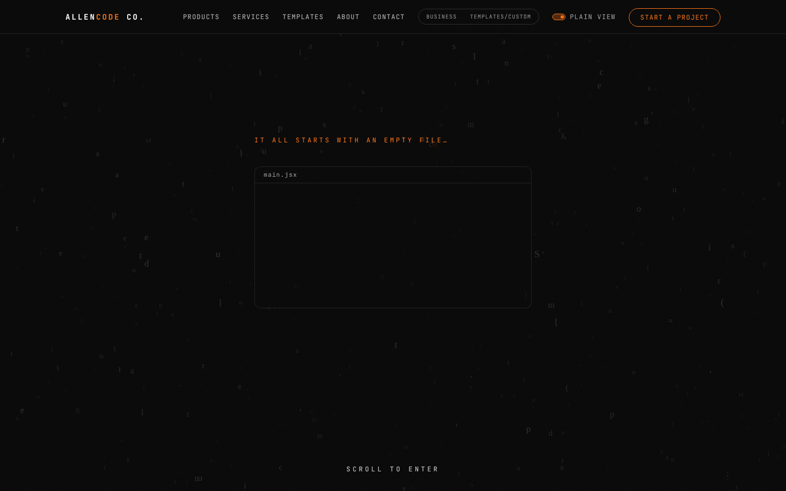
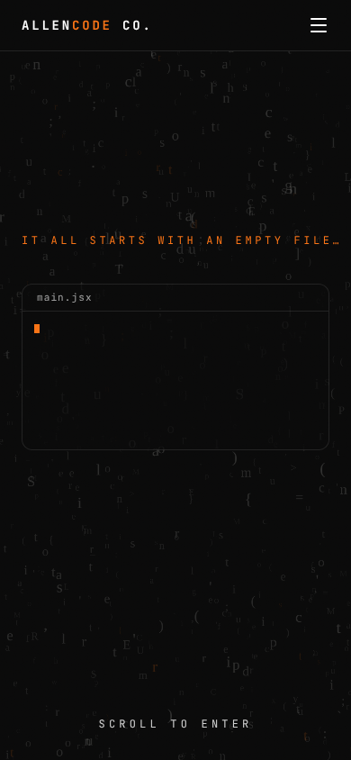
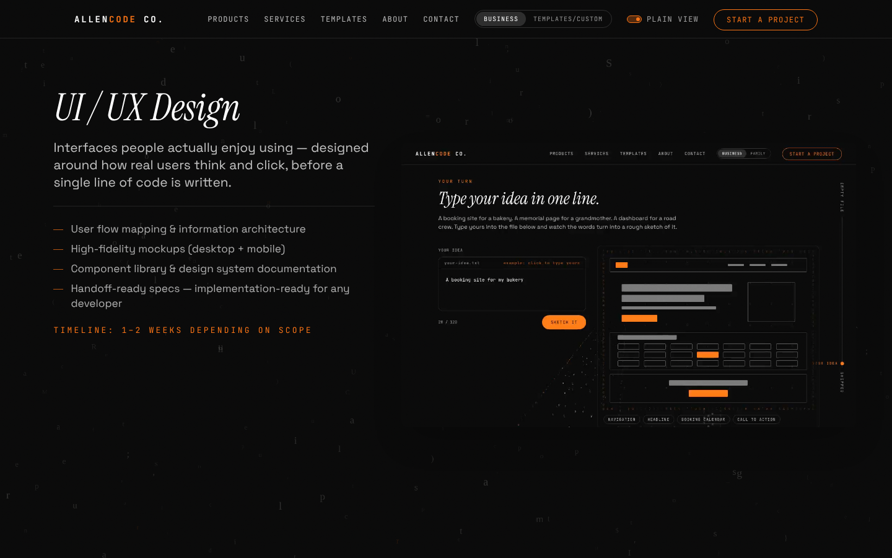
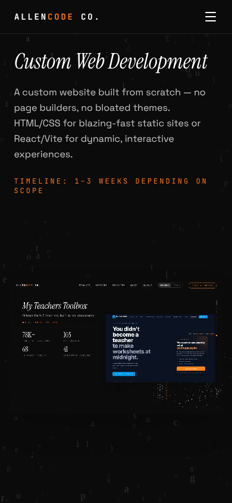

# The Living Source (2D): baseline

Measured and read on 2026-11-27. This is the record every later phase of the 2D plan
(`docs/superpowers/specs/2026-11-27-living-source-2d-design.md`) is measured against. "2D" means the
world off: Plain view, `?world=0`, no WebGL2, or reduced motion. Everything below was either measured
on the date above or read from the code at the file named; nothing is from memory. What could not be
measured here is listed at the end under "Not measured", and what Chris has to do is under "Owed: Chris".

The numbers were taken on `626a74a` (Chris's last commit) plus this phase's changes (the frame meter,
`src/components/PlainFrameMeter.jsx`, and the capture tool), before they were committed. Nothing in
`src/` changed for this document.

## What "2D" means in the code

There are three ways a visitor gets the 2D site, and they are not the same page:

1. **Plain view with WebGL2 and motion allowed** (the toggle, or `?world=0`). The Code World is off, but
   the glyph renderer (`src/field/FieldScene.jsx`, `FieldStage.jsx`) still runs after first paint, so the
   gate and every code-to-screen chapter still fly real characters onto their screen. This is what the
   capture and the four stills show, with software WebGL (see the machine note).
2. **No WebGL2, or the renderer fails** (`FieldScene.jsx` sets the field mode to `static`). The CSS code
   texture (`src/field/CssField.jsx`) stays; the gate and the flight chapters draw their static form (code
   beside the result). Chapters that do not need the renderer still pin and animate while motion is allowed:
   the audit checking its lines, the "How I Work" changelog, and the coming-soon file typing.
3. **Reduced motion.** Static everything: `FieldScene.jsx` never starts the renderer or the smooth-scroll
   engine, no chapter pins, loops do not play (`MediaLoop.jsx`), and `Reveal` is the only part of the
   inner pages that still mounts a motion wrapper (framer-motion honours the setting itself; see Fork's
   `MotionConfig reducedMotion="user"`).

The capture (Step 3) covered (1) at both sizes and (3) for door a at both sizes. It had no separate recording of
(2); that path is the same code as the static form of (3) plus the motion that still runs (the audit, the
changelog, coming-soon typing), read from the code, not recorded.

## Step 1: Inventory

One row per 2D surface. "Motion today" is read from the code; the timings are the constants in the files
named. Phase numbers are the spec's Phases (1 audit, 2 creative direction, 3 Project Explorer, 4 Source,
Transformation, Result and provenance, 5 product demonstrations, 6 transitions and narrative with the inner
pages, 7 mobile, accessibility and performance, 8 awards kit); letters are the spec's sections A to F.

### Shared by every page

| Part | Components | Motion today | Changes in |
| --- | --- | --- | --- |
| Frame | `src/App.jsx` (`AppShell`: skip link, `ScrollToTop`, `Noise`, `CustomCursor`, `Nav`, `Footer`, `Analytics`) | Nav is fixed over the page on every route; its phone menu opens with a height and opacity animation (`Nav.jsx`). Noise is a fixed 5 percent overlay (`Noise.jsx`). On a fine pointer a dot cursor follows the pointer and becomes a ring over links and buttons (`CustomCursor.jsx`). | 3 (explorer joins the navigation), 7 |
| Door switch | `src/components/Nav.jsx` (`DoorSwitcher`: Business, Templates/Custom), `src/door/DoorProvider.jsx` | Instant switch. | 3 |
| Code field | `src/field/FieldLayer.jsx`, `CssField.jsx`, `FieldScene.jsx` | Static CSS texture painted with the page; the WebGL renderer starts after the load event and browser idle (up to 1.5 s) and hides the texture while it draws. Eight copies of the ambient excerpt, 3.5 percent opacity. | 2, 7 |
| Scroll | `src/scroll/ScrollEngine.jsx` (Lenis, GSAP), `src/scroll/glide.js` | Smooth scrolling is on unless reduced motion; `glideTo` carries the fork's choice to the first chapter. | 3, 7 |
| Plain view | `src/components/PlainViewToggle.jsx`, `src/world/worldSwitch.js` | A switch in the footer and top bar; the page changes at once. Offered only where the world can run. | 3 |
| Page transitions | `viewTransition` on 16 `Link`s (grep of `src/`: `Nav.jsx` 6, `Services.jsx` 2, `ProductDetail.jsx` 2, `Footer.jsx` 1, `ProductCard.jsx` 1, `Templates.jsx` 1, `About.jsx` 1, `NotFound.jsx` 1, `CheckoutSuccess.jsx` 1) | The browser's default cross-fade between routes where View Transitions are supported. No named transitions or shared elements. | 6 (E) |
| Reveal | `src/components/Reveal.jsx` | Fade from 0 and rise 40 px over 0.7 s (ease `[0.16, 1, 0.3, 1]`), once, when 20 percent is in view; an optional delay. `instant` shows the content at once (used for first-screen content). Without JavaScript `index.html` shows every `[data-reveal]`. | 6 (E) |
| MediaLoop | `src/components/MediaLoop.jsx` | A poster image with a muted looping video over it: loads nothing until first play, plays only while 25 percent is in view (started 25 percent early), never plays under reduced motion, never has sound. | 5 (C) |
| Code panels | `src/field/CodeBeside.jsx`, `src/scenes/flight.jsx` (`EditorPanel`, `FlightEditor`), `src/field/CodeLines.jsx` | Static syntax-coloured code in an editor frame; long lines wrap. The caption read by assistive tech names the file, the repository and what it becomes. | 4 (A, D) |

### The home page, no door chosen (`src/pages/Home.jsx`)

| Section | Components | Motion today | Changes in |
| --- | --- | --- | --- |
| The gate: the empty file `main.jsx` becomes the headline "Welcome to Allen Code Co. What would you like to build today?" | `src/scenes/Gate.jsx`, `gateTimeline.js`, `headline.js`, `src/field/CodeBeside.jsx` (static form) | Pinned for 280 vh. Scroll types the real excerpt into the editor by 35 percent of progress; from 40 percent its characters lift and land as the headline in the glyph renderer; the real h1 takes over at 88 percent of the flight. A line ("It all starts with an empty file...") and "Scroll to enter" fade by 10 percent. Static (reduced motion or no WebGL): the code beside the headline, no pin. | 2 (refined), 4 (D), 7 |
| The fork, "Pick a file to open": business/ and family/ | `src/door/Fork.jsx`, `src/door/DoorProvider.jsx`, `doorStorage.js` | Hover or focus types the promise (CSS `fork-type`) beside a blinking cursor. Choosing a file: the other folds away (rotateX 55 degrees, 0.35 s), the chosen one spans the row with a 0.65 s light sweep, the field's intensity flares to 2.6 and settles over 1.7 s, and after 650 ms the page glides to the first chapter; the fork returns 1.9 s later. Reduced motion: applies at once and jumps. | 2, 3 (B) |

The page ends at the fork until a door is chosen (comment in `Home.jsx`).

### Door a (business/): `Home.jsx` renders these in this order

Services first, then products, then How I Work (spec F; this is the order the world road uses too).

| Section | Components | Motion today | Changes in |
| --- | --- | --- | --- |
| Services: MVP Sprints, Custom SaaS Builds, Custom Web Development, UI/UX Design, AI Integration (five chapters) | `src/scenes/ServiceChapters.jsx` (`FlightChapter`, `StaticChapter`), `src/data/services.js`, `src/data/serviceScreens.js`, `src/scenes/chapterTimeline.js`, `chapterType.js`, `flight.jsx` | Each is pinned for 220 vh. From 15 percent of progress the excerpt's characters fly (over 70 percent of the chapter) onto the real screen; at 88 percent of the flight the screen takes over. Web Development and UI/UX land on a poster and then a `MediaLoop`; the others land on a still. Words: name, summary, scope list, "Timeline: ..." (no prices in this chapter). Static form: words beside the code panel and the screen, no pin. | 4 (A, D), 5, 6 (E) |
| Technical Audits | same file (`AuditChapter`, `AuditPanel`), `auditTimeline` | Pinned 180 vh; the file stays put and its lines get an ember check one by one (10 to 90 percent of progress). Runs even without WebGL; static only under reduced motion. | 4, 6 |
| Products: My Teachers Toolbox, UnderFire AI, Founders Helm (live), Crew Advisors (coming soon) | `src/scenes/ProductChapter.jsx` (`FlightProductChapter`, `StaticProductChapter`, `ComingSoonChapter`), `src/data/products.js`, `src/components/MediaLoop.jsx` | Live: pinned 220 vh, code flies onto the loop's poster, then the loop plays; up to four stats count up over the first 55 percent of progress; a pulsing "Live" dot (motion-safe) and an "Open live site" link. Coming soon: pinned 160 vh, its file types from 15 to 65 percent and never finishes. | 5 (C), 4 |
| How I Work: three rules | `src/components/HowIWork.jsx` | Pinned 220 vh as a CHANGELOG.md; each entry's title types in, its body rises 12 px, a "shipped" tick appears; scaled down to fit short screens. Static under reduced motion. | 6 (F), 7 |

Only six of the seven services in `services.js` have a home chapter; Acquisition Readiness appears on
`/services` only. The spec's answer 2 (all seven listed) is for the explorer.

### Door b (family/)

| Section | Components | Motion today | Changes in |
| --- | --- | --- | --- |
| Intro: "A website that feels like yours." (Hearth) | `src/scenes/DoorBIntro.jsx`, `src/content/doorB.js` | Pinned 220 vh; the Hearth excerpt flies onto its loop poster, then the loop plays. Static: words, code and loop. | 4, 5, 6 |
| Templates, "Pick one. I make it yours.": six segments (Evergreen, Keepsake, Vow, Gather, Folio, Copper Thistle) | `src/scenes/TemplateChapter.jsx` (`DOOR_B_TEMPLATES`, `FlightTemplateChapter`, `TemplateSegment`), `src/data/templates.js` | One pinned section of 90 vh per segment plus 100 vh; the active segment's code flies onto its loop poster and the loop plays; a counter "n / 6" and a link to `/templates`. Static: a stack of the six with code panel and loop. | 4, 5, 6 |
| Done for you: "Rather not pick a template?" | `src/scenes/DoneForYou.jsx` | None (text and a link to the brief). | 6 |

### Shared tail of both doors

| Section | Components | Motion today | Changes in |
| --- | --- | --- | --- |
| The builder: Chris's portrait | `src/scenes/Builder.jsx`, `src/content/builderStory.js` | Pinned 220 vh when the renderer runs: the builder's code flies onto the portrait. Static: words, code panel and portrait (4:5). | 4, 6 (E: About code resolving into the portrait) |
| Your idea, "Type your idea in one line." | `src/scenes/IdeaSketch.jsx`, `sketchBlocks.js`, `src/content/visitorTurn.js` | With the renderer: the example line types itself (55 ms a character) once the chapter is 45 percent in view, then flies (2.6 s) into a wireframe; the visitor's own line does the same on Sketch it (scrolling more than 120 px ends the flight at once). The idea is kept in `?idea=`. Without the renderer the wireframe appears at once. | 6 (E: the idea carries into the brief) |
| The brief | `src/scenes/BriefChapter.jsx`, `src/components/ContactForm.jsx`, `briefPrefill.js` | The `# Project brief` file mirrors the form's fields as they are typed; a blinking cursor. No other motion. | 6 (E) |

### The five inner pages and the products

| Surface | Sections | Components | Motion today | Changes in |
| --- | --- | --- | --- | --- |
| `/services` | Header; seven service panels (name, summary, scope, timeline and deposit terms, "Reserve a slot"); "Not sure what you need?" | `src/pages/Services.jsx`, `PageHeader.jsx` (`PANEL`, `BUTTON`), `Magnetic.jsx` | `Reveal` per panel (delay 0.06 s a panel); buttons are pulled toward the pointer by a spring (`Magnetic.jsx`); border colour change on hover; route links use `viewTransition`. | 6 |
| `/products` | Header; a two-column grid of four cards (loop or file or image, tagline, "Open the showcase", live site) | `src/pages/Products.jsx`, `ProductCard.jsx`, `MediaLoop.jsx`, `TypingFile.jsx` | `Reveal` (first two instant); loops play in view; the coming-soon card types its file (`TypingFile`); live dot pulses. | 5, 6 |
| `/products/:slug` (the four sitemap pages) | Header, hero loop or image, stats, Problem and Build, a stack and results panel, then per product: Overview, Archetypes, Features (disclosures), Platform modules, Architecture, Security, a Pricing section where the product has one (three of the four), a closing call to action | `src/pages/ProductDetail.jsx`, `MediaLoop.jsx`, `Magnetic.jsx` | `Reveal` on every block; hero is instant; feature rows are native `details` elements with a rotating plus; loops play in view. No code excerpt and no provenance on these pages today. | 5 (C), 4 (D), 6 |
| `/templates` | Header; category filter; a three-column grid of all fourteen templates (loop, tags, status, Ask, demo) | `src/pages/Templates.jsx`, `MediaLoop.jsx`, `data/templates.js` | `Reveal` (first three instant); filter buttons; loops play in view. | 5, 6 |
| `/about` | Portrait and introduction; "git log --reverse" timeline of five entries; three value cards | `src/pages/About.jsx`, `Reveal`, `Magnetic` | `Reveal` per entry and card. | 6 (E), 3 |
| `/contact` | Header with email and booking link; response time; the form in a "your-project.md" panel | `src/pages/Contact.jsx`, `ContactForm.jsx` | `Reveal instant` only (so none in effect). | 6 |

All inner pages share `PageHeader.jsx`: a `~/allencode/<page>` path with a blinking cursor, the eyebrow and
a large serif title. They are bordered card stacks (`PANEL` is `rounded-xl border border-white/10`), which
is the part Chris called plain.

## Step 2: Numbers (2026-11-27)

### Machine and method

A cloud container with no GPU: any WebGL is software (SwiftShader), as in the earlier ledger rows
(`BLUEPRINT-SKY-REDESIGN.md`, Task 8.2). Chrome is `/usr/bin/google-chrome` (HeadlessChrome 153.0.0.0).
Lighthouse was **12.8.2** (`npx --yes lighthouse@12`), run once per page per form factor, against a fresh
`npm run build` served by `npm run preview -- --port 4173`, every URL with `?world=0`, categories
performance, accessibility and SEO, `--chrome-flags="--headless=new --no-sandbox"`. Phone is Lighthouse's
default (mobile emulation, simulated throttling; benchmark index 2234 for the home page run); desktop is
`--preset=desktop` (simulated throttling; benchmark index 2350). One run each, so the numbers carry
run-to-run noise; the only repeat was the home page's CLS below, which came out the same (0.199) in three runs in all.

### Lighthouse, phone (software WebGL available, Lighthouse default flags)

| Page | Performance | LCP | CLS | TBT | Accessibility | SEO |
| --- | --- | --- | --- | --- | --- | --- |
| `/` | 69 | 2.2 s | 0 | 1670 ms | 100 | 100 |
| `/products` | 57 | 4.1 s | 0.001 | 1810 ms | 100 | 100 |
| `/products/my-teachers-toolbox` | 62 | 2.9 s | 0.031 | 5130 ms | 100 | 100 |
| `/products/underfire-ai` | 68 | 2.8 s | 0 | 1430 ms | 100 | 100 |
| `/products/founders-helm` | 66 | 2.8 s | 0 | 1920 ms | 100 | 100 |
| `/products/crew-advisors` | 62 | 3.5 s | 0 | 1670 ms | 100 | 100 |
| `/services` | 68 | 2.2 s | 0.001 | 2250 ms | 100 | 100 |
| `/templates` | 53 | 5.1 s | 0.041 | 1330 ms | 100 | 100 |
| `/about` | 66 | 2.9 s | 0.001 | 1610 ms | 100 | 100 |
| `/contact` | 68 | 2.3 s | 0.001 | 1820 ms | 100 | 100 |

Total blocking time on the phone is 1.3 to 5.1 s on every page. That is the glyph renderer starting
(software WebGL on a throttled CPU); it is the same effect the earlier ledger recorded as "TBT 1.9 to
3.4 s with software WebGL". A real phone's GPU does not do this work on the CPU, which is why the
real-device frame numbers (Step 4) matter more than this column.

### Lighthouse, phone with WebGL off (extra: what a phone without a usable GPU gets)

The same ten pages with `--disable-3d-apis --disable-webgl` added to the Chrome flags, the setup the earlier
ledger used for its "mobile" rows (static form, CSS field). Same build, same day, same Lighthouse.

| Page | Performance | LCP | CLS | TBT | Accessibility | SEO |
| --- | --- | --- | --- | --- | --- | --- |
| `/` | 87 | 2.2 s | 0.199 | 50 ms | 100 | 100 |
| `/products` | 84 | 4.1 s | 0.001 | 50 ms | 100 | 100 |
| `/products/my-teachers-toolbox` | 91 | 3.2 s | 0.031 | 40 ms | 100 | 100 |
| `/products/underfire-ai` | 93 | 2.8 s | 0 | 110 ms | 100 | 100 |
| `/products/founders-helm` | 93 | 2.8 s | 0 | 80 ms | 100 | 100 |
| `/products/crew-advisors` | 94 | 2.9 s | 0 | 70 ms | 100 | 100 |
| `/services` | 97 | 2.0 s | 0.001 | 120 ms | 100 | 100 |
| `/templates` | 78 | 5.1 s | 0.041 | 80 ms | 100 | 100 |
| `/about` | 92 | 3.0 s | 0.001 | 110 ms | 100 | 100 |
| `/contact` | 94 | 2.4 s | 0.001 | 110 ms | 100 | 100 |

Against the earlier ledger (2026-11-10: mobile with WebGL off, performance 79 to 91, LCP 2.9 to 5.0 s,
TBT at most 150 ms), performance now runs 78 to 97 and TBT 40 to 120 ms. Confirmed: **the home page on
a phone with no WebGL has CLS 0.199, over the 0.1 target.** This matches the blueprint's known limitation ("no-WebGL visitors see one layout shift on the gate", `BLUEPRINT-SKY-REDESIGN.md`), assigned to Phase 7 (mobile, accessibility and performance). It repeated at 0.199 in two further runs (three runs in all), and
Lighthouse names the page's first `section` (the gate) as the shifting element: the gate is pinned at 280 vh
until the renderer reports that WebGL is unavailable, then switches to its static layout. It is 0 on the
same page with WebGL available (table above). The cause was read from `Gate.jsx` (`isStatic`) and the
Lighthouse layout-shift audit; no fix was tried, as this phase records only.

### Lighthouse, desktop (`--preset=desktop`)

| Page | Performance | LCP | CLS | TBT | Accessibility | SEO |
| --- | --- | --- | --- | --- | --- | --- |
| `/` | 100 | 0.5 s | 0.003 | 0 ms | 100 | 100 |
| `/products` | 99 | 0.8 s | 0.003 | 0 ms | 100 | 100 |
| `/products/my-teachers-toolbox` | 99 | 0.6 s | 0.003 | 0 ms | 100 | 100 |
| `/products/underfire-ai` | 100 | 0.6 s | 0.003 | 10 ms | 100 | 100 |
| `/products/founders-helm` | 100 | 0.6 s | 0.003 | 0 ms | 100 | 100 |
| `/products/crew-advisors` | 100 | 0.7 s | 0.003 | 20 ms | 100 | 100 |
| `/services` | 100 | 0.5 s | 0.003 | 10 ms | 100 | 100 |
| `/templates` | 97 | 1.1 s | 0.003 | 0 ms | 100 | 100 |
| `/about` | 100 | 0.7 s | 0.033 | 0 ms | 100 | 100 |
| `/contact` | 100 | 0.5 s | 0.003 | 0 ms | 100 | 100 |

The slowest pages are `/templates` (phone LCP 5.1 s in both phone runs; desktop 97) and `/products` (phone
LCP 4.1 s). Accessibility and SEO are 100 on all 30 runs.

### The size budget (`npm run budget`, 2026-11-27, after `npm run verify`'s build)

```
ok    entry script (every page)             147.97 kB of 152 kB  index-Y1Pw3A7R.js
ok    entry CSS (every page)                  7.97 kB of 9 kB  index-Duna5GxZ.css
ok    home page chunk                        10.27 kB of 16 kB  Home-5GGyqiI0.js
ok    renderer chunk (after first paint)      3.42 kB of 5 kB  FieldScene-Df5OAXjV.js
ok    scroll vendor: GSAP and Lenis (after first paint)   51.15 kB of 54 kB  vendor-scroll-DVi_bg0T.js
ok    code world layer and canvas (world only)   16.75 kB of 17 kB  WorldLayer-BVX4q_nh.js
ok    code world journey (world only)         2.16 kB of 2.3 kB  WorldJourney-yMwVk5qv.js
ok    any other script chunk                  2.54 kB of 12 kB  JourneyRail-D7ZBgkTr.js
ok    any other script chunk                  0.44 kB of 12 kB  PlainFrameMeter-C8TyZIin.js
ok    any other script chunk                  3.22 kB of 12 kB  ScrollEngine-CrH2N6g4.js
ok    any other script chunk                  0.29 kB of 12 kB  capabilities-r23PXQit.js
ok    any other script chunk                  0.26 kB of 12 kB  frameMeter-BYtg2Q1L.js
ok    any other script chunk                  9.84 kB of 12 kB  index-DWfvtvbC.js
ok    any other script chunk                 10.55 kB of 12 kB  journey-D1UNUOyv.js
ok    any other script chunk                  7.48 kB of 12 kB  roads-BbckbWKm.js
ok    any other script chunk                  4.45 kB of 12 kB  stretchWorld-D1RIf865.js
```

Every limit passes. The tightest are the entry script (about 4 kB headroom), the scroll vendor (about 2.9 kB)
and the code world layer (0.25 kB; world only, not part of the 2D budget). Any 2D feature that adds to the
entry script or the scroll vendor will need a budget decision.

### Tests

| Command | Result (2026-11-27) |
| --- | --- |
| `npm run verify` (lint, typecheck, unit tests, build, budget) | Exit 0, the final run of the phase. Lint and typecheck clean. Unit tests: 76 files, **586 of 586 passed**, 0 failed. Build prerendered 10 pages and the shell (`spa.html`). Budget as above. |
| `npm run test:e2e` (cloud Chrome, software WebGL) | Exit 0. **268 passed, 0 failed, 0 skipped**, the final run of the phase. The world specs (`worldhome`, `worldjump`, `worldmeeting`, `worldtoggle`, `worldcls` and others) also passed here on software WebGL; they test the 3D world and are not part of this baseline. The accessibility (`a11y.spec.js`) and SEO (`seo.spec.js`) specs are in the 268. |
| `npm run excerpts:verify` | **Not run here. Owed: Chris** (see below). |

## Step 3: Pictures

### The capture

`npm run baseline:capture` (`tools/baseline/`) ran on 2026-11-27 (started 19:49 UTC, 745 s,
26 targets, 0 errors) against the preview build at `http://localhost:4173`. The files are in
`baseline-captures/2026-11-27/` (git-ignored, so they live on the machine that ran the capture and are not in
the repository). Captures live in `baseline-captures/` because Playwright clears `test-results/` at the start
of every `npm run test:e2e`. The folder holds `manifest.json`, and for each target `<id>.png` (full page),
`<id>.webm` (recording) and `<id>/frame-NNN.png` (one viewport-sized frame per viewport height).

Method, from the manifest: the world is off for every target (`sessionStorage allencode:world = 0`); the
window scrolls top to bottom at 600 px a second, stopping about 400 ms at the top, at every viewport height and
at the bottom; at each stop a viewport-sized screenshot; one full-page screenshot per target, taken after the
scroll-through (blank below the first screen on the home page's pinned scenes, so use the frames for stills);
one recording per target covering load, settle and the scroll-through. Viewports are 1440 by 900 (desktop) and
390 by 844 (phone, touch). Software WebGL, so the flights are real but slower than on a GPU.

| Target | Page height (px) | Frames |
| --- | --- | --- |
| `home-desktop` | 3482 | 4 |
| `home-phone` | 4302 | 6 |
| `products-desktop` | 2435 | 3 |
| `products-phone` | 3909 | 5 |
| `products-my-teachers-toolbox-desktop` | 7629 | 9 |
| `products-my-teachers-toolbox-phone` | 13221 | 16 |
| `products-underfire-ai-desktop` | 8279 | 10 |
| `products-underfire-ai-phone` | 14475 | 18 |
| `products-founders-helm-desktop` | 7636 | 9 |
| `products-founders-helm-phone` | 14878 | 18 |
| `products-crew-advisors-desktop` | 3694 | 5 |
| `products-crew-advisors-phone` | 5297 | 7 |
| `services-desktop` | 3693 | 5 |
| `services-phone` | 6463 | 8 |
| `templates-desktop` | 3998 | 5 |
| `templates-phone` | 9378 | 12 |
| `about-desktop` | 2742 | 4 |
| `about-phone` | 4887 | 6 |
| `contact-desktop` | 1396 | 2 |
| `contact-phone` | 2846 | 4 |
| `home-door-a-desktop` | 27854 | 32 |
| `home-door-a-phone` | 27936 | 34 |
| `home-door-b-desktop` | 15056 | 17 |
| `home-door-b-phone` | 16022 | 19 |
| `home-door-a-reduced-desktop` | 14761 | 17 |
| `home-door-a-reduced-phone` | 21749 | 26 |

The home page "no door" targets stop at the fork (the page ends there); the door a and door b targets have
the fork choice stored first. The two "reduced" targets are the static form (reduced motion).

### Four stills

Copied into this folder from the first capture run of the day (same build) (viewport-sized, PNG, each under 500 KB). No dollar amounts appear in any of them.

| Still | Source | What it shows |
| --- | --- | --- |
|  | `home-desktop/frame-000.png` (142 KB) | Home, no door, desktop: the gate before any scrolling. |
|  | `home-phone/frame-000.png` (110 KB) | Home, no door, phone: the gate before any scrolling. |
|  | `home-door-a-desktop/frame-011.png` (329 KB) | Door a, desktop: the UI/UX Design chapter after its code has flown onto its screen (the poster of the idea-sketch chapter). Words on the left, including the "Timeline" line. |
|  | `home-door-a-phone/frame-009.png` (150 KB) | Door a, phone: the Custom Web Development chapter (heading, summary, timeline line) with its screen showing the service's loop (this site's own Code World, recorded from this build) at the moment it reaches this site's My Teachers Toolbox chapter, and a few stray glyphs still arriving (the pinned chapters stop at fixed viewport heights, not at the end of the flight). |

## Step 4: Chris's devices

**Owed: Chris.** I could not run this: it needs a real iPhone and the desktop GPU. Nothing is filled in
below.

Procedure, with the meter that `?meter=1` adds in Plain view (`src/components/PlainFrameMeter.jsx`):

1. Open the site on a build that contains the meter, with `?world=0&meter=1` in the address: on the iPhone
   in Safari, and on the desktop. A line at the bottom left reads `plain · frames N · median X ms · p95 Y ms`.
2. The meter keeps only the last 2000 frame intervals (`KEEP` in `src/world/frameMeter.js`: about 33 s at
   60 Hz, about 14 s at 144 Hz), ignores gaps over 250 ms (a paused tab) and never resets while the page is
   open. So each door is measured in **two runs, with a reload between them**, and every run starts from a
   fresh page.
3. Door a, run A (fork to the end of the products): reload, choose business/ at the fork, then scroll in one
   go through the service chapters and the product chapters, and stop at the end of the last product
   chapter, just before How I Work. Write down the readout.
4. Door a, run B (How I Work to the brief): reload, choose business/ again, scroll quickly down to the top of
   How I Work, wait 3 s, and write down the readout's `frames` as the starting count. Then scroll at your
   normal pace through How I Work, the builder and your idea to the brief, and write down the readout.
5. Door b, run A (fork to the end of the templates): reload, choose family/, then scroll through the door b
   introduction and the template chapters, and stop at the end of the last template chapter, just before
   Done For You. Write down the readout.
6. Door b, run B (Done For You to the brief): reload, choose family/, scroll quickly to the top of Done For
   You, wait 3 s, note the starting `frames`, then scroll at your normal pace through Done For You, the
   builder and your idea to the brief and write down the readout.
7. `/services`: open `/services?world=0&meter=1` and scroll top to bottom once. `/products/underfire-ai`:
   the same on `/products/underfire-ai?world=0&meter=1`.
8. If `frames` reads 2000 at the end of a run, the window was full: the median and p95 cover only the last
   2000 frames (the last part of the run), not all of it. Write "full window" in the notes column. For runs B,
   the quick scroll to the start point counts toward the frames; the starting count tells you how many of
   them are in the window.
9. In the last column, say in your own words anything that felt slow, rough, jumpy or late (for example
   "the gate lagged when the letters lifted").

| Device | Page, door and run | Starting frames | Frames at the end | Median (ms) | p95 (ms) | Notes (full window? what felt slow or rough) |
| --- | --- | --- | --- | --- | --- | --- |
| iPhone, Safari | `/` door a, run A (fork to the end of the products) | | | | | |
| iPhone, Safari | `/` door a, run B (How I Work to the brief) | | | | | |
| iPhone, Safari | `/` door b, run A (fork to the end of the templates) | | | | | |
| iPhone, Safari | `/` door b, run B (Done For You to the brief) | | | | | |
| iPhone, Safari | `/services` | | | | | |
| iPhone, Safari | `/products/underfire-ai` | | | | | |
| Desktop | `/` door a, run A (fork to the end of the products) | | | | | |
| Desktop | `/` door a, run B (How I Work to the brief) | | | | | |
| Desktop | `/` door b, run A (fork to the end of the templates) | | | | | |
| Desktop | `/` door b, run B (Done For You to the brief) | | | | | |
| Desktop | `/services` | | | | | |
| Desktop | `/products/underfire-ai` | | | | | |

Also **owed: Chris**, on the machine where the other repositories are mounted:

```
npm run excerpts:verify
```

It checks every code excerpt on the site still matches its source repository at the recorded commit. It
could not run in the container this baseline was taken in, so its result is not in this document; record it
here when run: ______ (date, pass or fail).

## Not measured

- Frame times on any real device (Step 4), and on this machine (no GPU; software WebGL makes them
  meaningless).
- A real-device Lighthouse run. The phone numbers above are emulated on a CPU-only container.
- The WebGL-unavailable phone path was measured with Lighthouse (extra table) but not recorded on video, and
  desktop Lighthouse with WebGL off was not run.
- INP (the 200 ms target): Lighthouse's lab runs do not measure it, and nothing here interacts with the pages.
- The excerpt check (`npm run excerpts:verify`), and the 3D world, which has its own baseline.
- Touch and keyboard behaviour were not re-tested by hand; the accessibility and SEO e2e specs passed.

## Things the baseline found that the later phases should know

- The 2D site is not static in Plain view: with WebGL2 and motion allowed it still runs the glyph flights.
  "World off" and "static" are different states (section "What 2D means").
- Home page CLS on a phone with no WebGL is 0.199 (over the target), the known gate limitation, for Phase 7; other pages are at or under 0.041.
- Phone TBT is 1.3 to 5.1 s with software WebGL; WebGL off, it is 40 to 120 ms.
- The inner pages carry no code excerpts and no provenance; their only motion is `Reveal` and the shared
  hover and route cross-fade.
- `/services` shows each service's deposit terms, and three of the four product pages carry their own
  Pricing section (`ProductDetail.jsx`, `pricing` in `src/data/products.js`). These are consistent with the
  site's rules: product pages keep their pricing (Chris's standing decision), the no-prices rule covers services
  and templates, and deposit terms are terms, not prices. No amounts are copied here.
